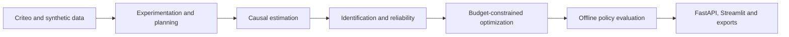
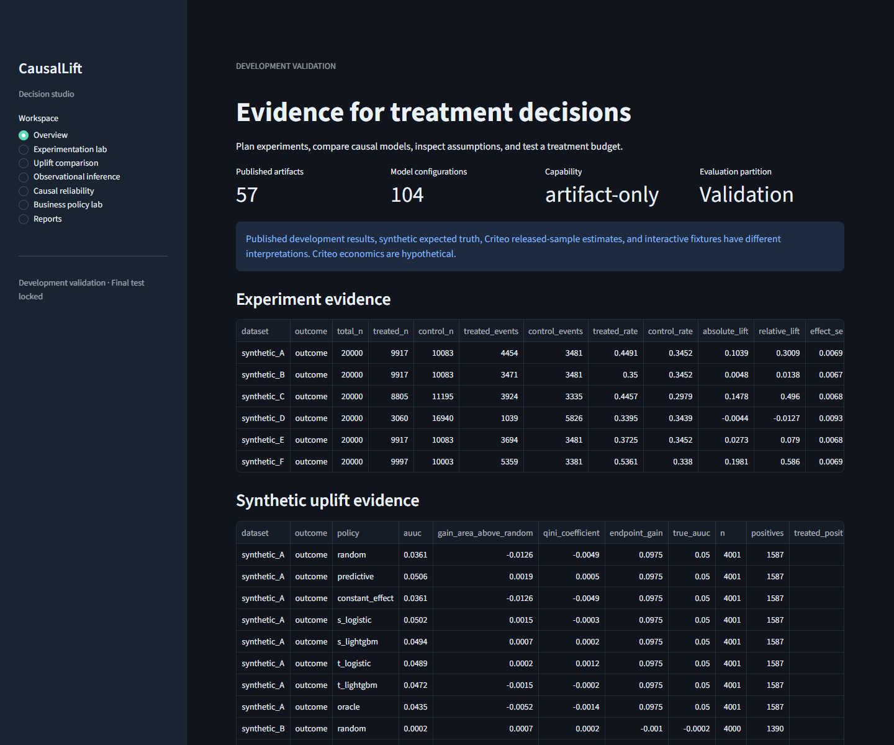
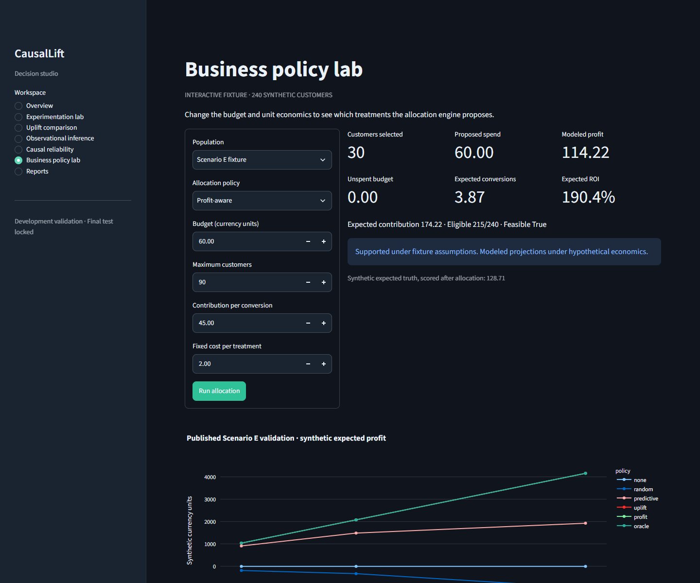

# CausalLift

CausalLift is a local-first research and decision-support platform for measuring whether an intervention changes outcomes, choosing whom to treat under a budget, and evaluating the resulting policy on held-out data.

A predictive score ranks people by how likely they are to convert. A causal score estimates how much treatment changes that probability. The policy lab combines estimated incremental effects with contribution, treatment cost, eligibility and capacity to produce a proposed allocation. The offline evaluator then estimates how that allocation would have performed using logged outcomes.

## Analytical flow



The analytical engine includes A/B inference, power and CUPED, S/T/X/R learners, DML and Causal Forest, DAGs and observational adjustment, and fixed-policy DM, IPS, SNIPS and DR evaluation. The dashboard keeps historical validation, locked test aggregates and interactive fixture results distinct.

## Representative evidence

| Population | Measured result |
| --- | --- |
| Released Criteo archive | 13,979,592 rows verified. Conversion assignment difference **+0.1152 pp** with a 95% interval of **[0.1084, 0.1219] pp**. |
| Criteo 1M validation | Pooled LightGBM conversion ROC-AUC **0.9571**, AP **0.24608**. |
| Synthetic E locked test | Profit-aware vs. predictive paired DR profit **286.82**, conditional 95% CI **[−2,883.03, 3,456.67]**. Simulator expected difference **2,179.80**. |
| Criteo 1M locked test | Profit-aware vs. predictive paired DR profit **11,117.61** hypothetical units, conditional 95% CI **[4,858.33, 17,376.90]**. Proposed spend was **2,567.60** vs. **16,000**. The interval against treat-none included zero. |

All six frozen cohorts completed. The locked test covers the representative policy models. Original Criteo trial propensities and clusters are unavailable, its two working benchmarks overlap, and the business inputs are hypothetical. The primary Criteo test cohort has 58 control conversions. Synthetic F remains research-only, and high-dimensional DML interval coverage was 0/30 in the earlier diagnostic. [Consolidated benchmark](docs/FINAL_BENCHMARK_REPORT.md) · [Locked evaluation manifest](artifacts/session_14/final_evaluation_manifest.json)

## Dashboard





These screenshots show the Session 13 interface. The current Overview and Reports views also show the locked test aggregates.

## Quick start

Use Python 3.11 or 3.13. Run from the repository root.

```sh
python -m pip install -e ".[dev,platform]"
python -m uvicorn causallift.platform.api:app --port 8000
```

In a second terminal, run `python -m streamlit run dashboard/app.py`. Open the dashboard at `http://127.0.0.1:8501` and the API explorer at `http://127.0.0.1:8000/docs`. Run `docker compose up --build` to start both services together. The public checkout supports the full artifact-only demo using published aggregates and deterministic fixture scores.

```sh
python -m causallift.session14 --fixture
```

Replay of the original locked benchmark requires the exact local datasets and frozen model binaries. See the [reproduction guide](docs/REPRODUCTION.md) for acquisition, previous workflows, exact replay and verification commands.

## Repository map

| Path | Contents |
| --- | --- |
| [src/causallift](src/causallift) | Analytical modules, session runners and API services |
| [dashboard](dashboard) | Seven Streamlit views and exports |
| [artifacts](artifacts) | Published compact results and provenance by session |
| [tests](tests) | Statistical, pipeline and platform checks |
| [docs](docs) | Methods, evidence and all 14 completion reports |

[Architecture](docs/PLATFORM_ARCHITECTURE.md) · [Interview demo](docs/DEMO_GUIDE.md) · [Resume evidence](docs/RESUME_EVIDENCE.md) · [Release verification](docs/session-14-completion.md)
